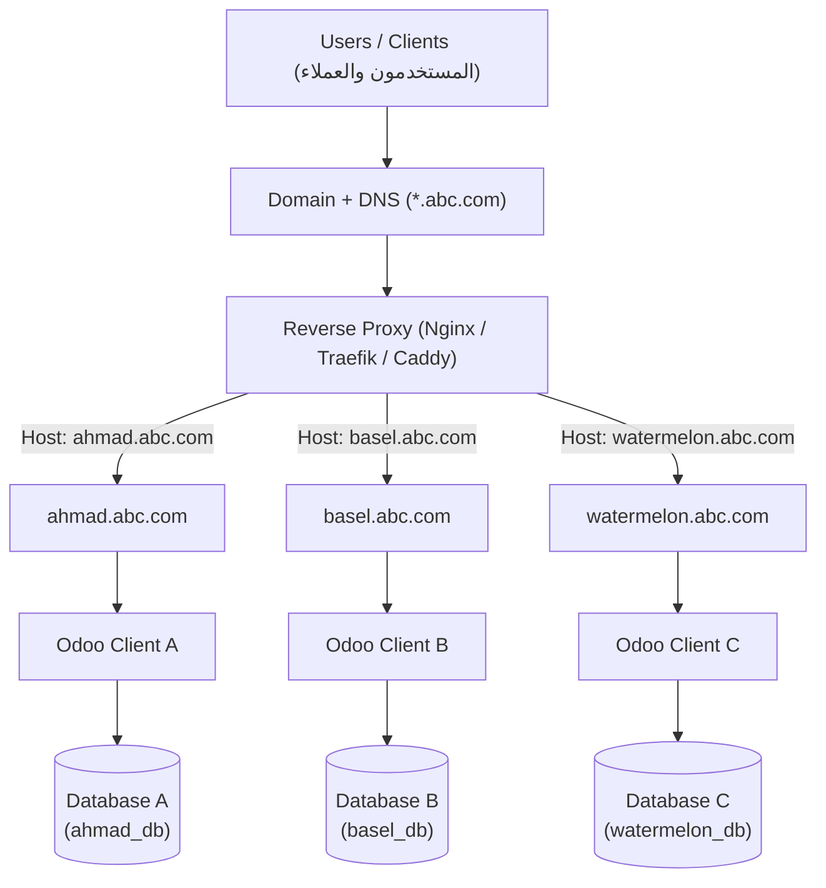

# المعمارية المستهدفة لمنظومة أودو المتعددة للعملاء (Multi-Tenant Odoo SaaS Architecture)

تحدد هذه الوثيقة الرؤية والمعمارية الهندسية المستهدفة لتشغيل نظام Odoo لخدمة عدة عملاء عبر نطاقات فرعية مستقلة وقواعد بيانات معزولة.

---

## 1. المخطط العام للمنظومة (Architecture Flowchart)



---

## 2. تفصيل طبقات المنظومة ومكوناتها

### أولاً: طبقة النطاق وإدارة الـ DNS (Domain & DNS Layer)
- **Wildcard DNS (`*.abc.com`):** توجيه السجل `A` أو `CNAME` للنطاق الشامل نحو عنوان IP الخاص بالخادم (Reverse Proxy).
- يتيح هذا إنشاء أي عميل فرعي جديد (مثل `client_x.abc.com`) تلقائياً دون الحاجة لتعديل سجلات الـ DNS في كل مرة.

---

### ثانياً: طبقة الوسيط العكسي وإدارة شهادات الأمان (Reverse Proxy & SSL)
الخيارات المتاحة: **Nginx** (الأكثر استقراراً وشيوعاً مع أودو) أو **Traefik** (توجيه ديناميكي ممتاز مع Docker) أو **Caddy** (تجديد SSL تلقائي بدون إعدادات معقدة).

**المهام الأساسية للوسيط العكسي:**
1. **تشفير الاتصال (SSL / HTTPS):** إصدار وتجديد شهادة Wildcard SSL تلقائياً عبر Let's Encrypt.
2. **فحص الـ Host Header:** قراءة النطاق الفرعي المطلوب (مثل `ahmad.abc.com`) وتوجيهه إلى الوجهة المناسبة.
3. **توجيه الـ Websocket / Longpolling:** تمرير اتصالات `/websocket` أو المنفذ الخاص بها لدعم المحادثات والتنبيهات اللحظية في أودو.
4. **حماية أودو وضبط الأمان:** تحديد أحجام الرفع القصوى (`client_max_body_size`)، وتفعيل الـ Gzip Caching للأصول الثابتة (CSS/JS).

---

### ثالثاً: طبقة تطبيق أودو والتعددية (Multi-Tenancy Options)

هناك طريقتان رئيسيتان لتنفيذ هذه المعمارية:

#### الخيار (أ) - العزل عبر بيئة أودو موحدة (Native Multi-Tenancy via dbfilter):
- يعمل خادم Odoo واحد أو مجموعة عمال (Workers) مشتركة.
- يتم تفعيل فلترة قواعد البيانات عبر إعداد:
  ```ini
  dbfilter = ^%d$
  ```
- **كيف تعمل؟** عندما يزور العميل `ahmad.abc.com`، يقوم أودو باستخلاص `%d` وهي كلمة `ahmad`، ويربط المستخدم فورياً بقاعدة بيانات اسمها `ahmad` ويخفي تماماً باقي قواعد البيانات وشاشة اختيارها.
- **المميزات:** توفير كبير في استهلاك موارد السيرفر (RAM / CPU).

#### الخيار (ب) - العزل الكامل للحاويات (Container-per-Client Isolation):
- يتم إنشاء حاوية Docker مستقلة لكل عميل (مثلاً: حاوية لأحمد، وحاوية لباسل، وحاوية لـ watermelon).
- **المميزات:** 
  - إمكانية تشغيل إصدارات مختلفة، أو تثبيت موديولات وتخصيصات خاصة بكل عميل دون التأثير على بقية العملاء.
  - أمان واستقرار كامل؛ إذا حدث خطأ أو توقف في تطبيق أحد العملاء، لا يتأثر الآخرون.
- **المآخذ:** تستهلك ذاكرة وصول عشوائي (RAM) أعلى مقارنة بالخيار (أ).

---

### رابعاً: طبقة قواعد البيانات المعزولة (Database Layer)
- خادم **PostgreSQL** موحد أو عنقودي (Cluster).
- إنشاء قاعدة بيانات منفصلة تماماً لكل عميل:
  - `Database A` لعميل أحمد.
  - `Database B` لعميل باسل.
  - `Database C` لعميل watermelon.
- عزل كامل للبيانات، مما يتيح أخذ نسخ احتياطية (Backup/Restore) لكل عميل بشكل مستقل.

---

## 3. خارطة طريق التنفيذ العملي (Roadmap)

1. **المرحلة 1: تجهيز السيرفر وحاوية الـ Reverse Proxy:**
   - إعداد Traefik أو Nginx مع شهادة تجريبية أو رسمية.
2. **المرحلة 2: إعداد PostgreSQL المركزي:**
   - خادم قاعدة بيانات محمي ومحسن للأداء.
3. **المرحلة 3: ضبط Odoo وآلية فلترة النطاقات (dbfilter أو docker orchestration):**
   - اختبار التوجيه التلقائي عبر النطاقات الفرعية.
4. **المرحلة 4: الأتمتة (Automation / Provisioning):**
   - كتابة سكريبت أو لوحة تحكم مصغرة لإنشاء مستأجر جديد (Tenant) بضغطة زر (إنشاء قاعدة البيانات + تفعيل النطاق).
